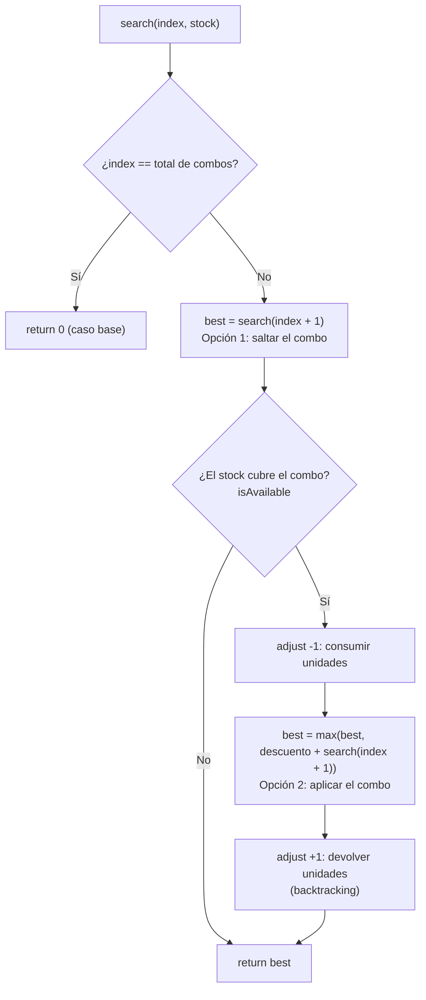
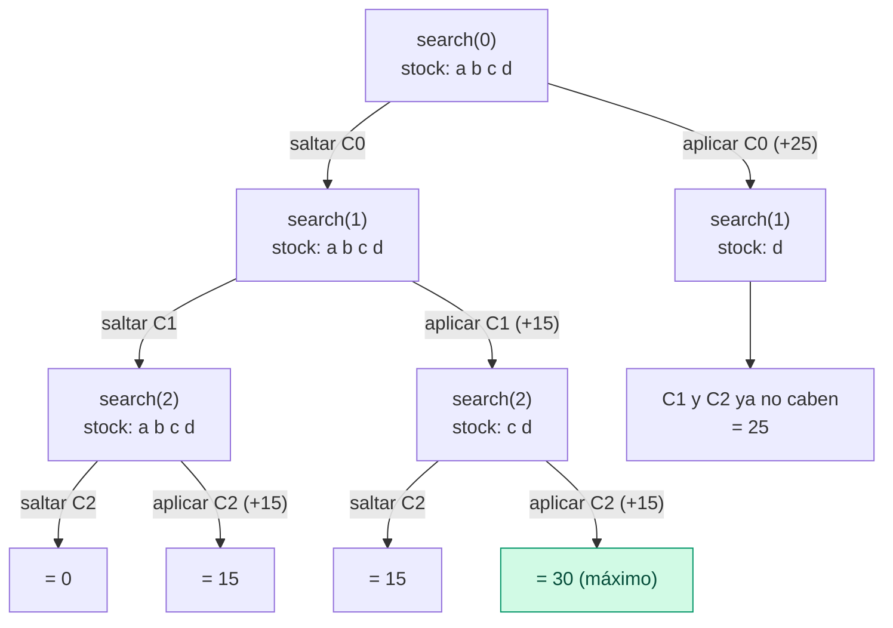

# Cinema Orders API

[English](README.md) | **Español**

Microservicio REST para gestionar **órdenes de compra temporales** de una cadena de cines. El cliente agrega boletos (`TICKET`) y alimentos (`FOOD`) a una orden antes de pagar. El proyecto incluye además un motor de **descuento por combo** (`DiscountCalculator`), listo para integrarse con las órdenes en un siguiente sprint.

## Contenido

1. [Tecnologías](#tecnologías)
2. [Cómo ejecutarlo](#cómo-ejecutarlo)
3. [Estructura del proyecto](#estructura-del-proyecto)
4. [Endpoints](#endpoints)
5. [Reglas de negocio y validaciones](#reglas-de-negocio-y-validaciones)
6. [Manejo de errores](#manejo-de-errores)
7. [DiscountCalculator: cómo funciona](#discountcalculator-cómo-funciona)
8. [Pruebas](#pruebas)
9. [Decisiones de diseño](#decisiones-de-diseño)

## Tecnologías

| Tecnología | Uso |
|---|---|
| Java 21 | Lenguaje |
| Spring Boot 3.5 (`spring-boot-starter-web`) | API REST |
| Bean Validation (`spring-boot-starter-validation`) | Validación de entradas |
| Lombok | Reduce código repetitivo en los modelos |
| Jackson | JSON en `snake_case` (`spring.jackson.property-naming-strategy=SNAKE_CASE`) |
| `ConcurrentHashMap` | Persistencia in-memory (no hay base de datos) |
| JUnit 5 + MockMvc (`spring-boot-starter-test`) | Pruebas unitarias y de integración |
| Maven | Construcción |

## Cómo ejecutarlo

Requisitos: **JDK 21** y **Maven 3.9+** (o el wrapper `./mvnw` si el repositorio lo incluye).

```bash
mvn spring-boot:run          # levanta la API en http://localhost:8080
mvn test                     # todas las pruebas
mvn test -Dtest=DiscountCalculatorTest   # solo las pruebas del descuento
```

La carpeta `postmanCollections/` contiene una colección de Postman para probar los endpoints.

## Estructura del proyecto

```
src/main/java/com/cinema
├── CinemaOrdersApplication.java
├── challenge/
│   └── DiscountCalculator.java        # algoritmo de descuento máximo por combo
├── controller/
│   └── OrderController.java           # endpoints REST y códigos HTTP
├── exception/
│   ├── GlobalExceptionHandler.java    # @RestControllerAdvice
│   ├── (OrderNotFound | OrderNotDeletable | InvalidOrder | InvalidRequest | BusinessException)Exception.java
│   └── model/                         # estructura de la respuesta de error
│       ├── ApiError.java
│       └── ErrorDetail.java
├── model/
│   ├── Order.java, Item.java, ItemType.java, OrderStatus.java
│   └── request/                       # bodies de las peticiones
│       ├── CreateOrderRequest.java    # body del POST
│       ├── UpdateOrderRequest.java    # body del PATCH
│       └── ItemRequest.java
├── repository/
│   └── OrderRepository.java           # ConcurrentHashMap
└── service/
    └── OrderService.java              # reglas de negocio
```

Flujo de una petición: `Controller` (HTTP y validación de formato) → `Service` (reglas de negocio) → `Repository` (almacenamiento). Los errores se traducen en un único lugar: `GlobalExceptionHandler`.

## Endpoints

Base: `/v1/countries/{country}/orders`

| Método | Endpoint | Descripción | Status |
|---|---|---|---|
| `POST` | `/v1/countries/{country}/orders` | Crear una orden | `201` (con header `Location`) |
| `GET` | `/v1/countries/{country}/orders/{orderId}` | Obtener una orden | `200` |
| `PATCH` | `/v1/countries/{country}/orders/{orderId}` | Actualizar `items` y/o `status` | `200` |
| `DELETE` | `/v1/countries/{country}/orders/{orderId}` | Eliminar una orden `PENDING` | `204` |

Parámetros de ruta: `country` son 2 letras (por ejemplo `MX`; se guarda en mayúsculas) y `orderId` es un UUID.

### Crear orden

```bash
curl -X POST http://localhost:8080/v1/countries/MX/orders \
  -H "Content-Type: application/json" \
  -d '{"cinema_id":472,"user_id":"user-123","items":[
        {"type":"TICKET","name":"Adulto","price":85},
        {"type":"FOOD","name":"Combo 1","price":120}]}'
```

Respuesta `201 Created`:

```json
{
  "order_id": "3f2c9a1e-5b7d-4c1a-9e2f-0a1b2c3d4e5f",
  "country": "MX",
  "cinema_id": "472",
  "user_id": "user-123",
  "items": [
    { "type": "TICKET", "name": "Adulto", "price": 85.00 },
    { "type": "FOOD", "name": "Combo 1", "price": 120.00 }
  ],
  "total": 205.00,
  "status": "PENDING",
  "created_at": "2026-10-28T10:30:00"
}
```

### Obtener, actualizar y eliminar

```bash
curl http://localhost:8080/v1/countries/MX/orders/{orderId}

curl -X PATCH http://localhost:8080/v1/countries/MX/orders/{orderId} \
  -H "Content-Type: application/json" \
  -d '{"items":[{"type":"TICKET","name":"Adulto","price":85}]}'

curl -X PATCH http://localhost:8080/v1/countries/MX/orders/{orderId} \
  -H "Content-Type: application/json" \
  -d '{"status":"CONFIRMED"}'

curl -X DELETE http://localhost:8080/v1/countries/MX/orders/{orderId}
```

Valores de `status`: `PENDING`, `CONFIRMED`, `CANCELLED`. Tipos de item: `TICKET`, `FOOD`.

## Reglas de negocio y validaciones

**Negocio**

- El `total` se calcula automáticamente: suma de los precios de los items, con 2 decimales.
- Al crear: se asigna un UUID, el status `PENDING` y la fecha de creación.
- Una orden debe tener **al menos un item `TICKET`**; el resto puede ser `FOOD`.
- Solo se puede eliminar una orden en `PENDING`.
- El PATCH solo modifica `items` y `status`. Si cambian los items, se recalcula el `total`.
- El `country` del path debe coincidir con el de la orden; de lo contrario, la orden se considera no encontrada.

**Validación de formato (HTTP 400)**

| Campo | Regla |
|---|---|
| `cinema_id` | Obligatorio, entero mayor a 0. Mensaje: `cinema_id invalido. El valor debe ser mayor a 0.` |
| `user_id` | Obligatorio, no vacío |
| `items` | Lista obligatoria, con al menos un elemento |
| `items[].type` | Obligatorio (`TICKET` o `FOOD`) |
| `items[].name` | Obligatorio, no vacío |
| `items[].price` | Obligatorio, mayor a 0, máximo 2 decimales |
| `status` (PATCH) | Debe ser un valor válido de `OrderStatus` |
| `{orderId}` | Formato UUID |
| `{country}` | 2 letras |

## Manejo de errores

Todos los errores usan la misma estructura (`ApiError`):

```json
{
  "timestamp": "2026-10-28T10:15:30",
  "status": 400,
  "error": "Bad Request",
  "code": "VALIDATION_ERROR",
  "message": "Request validation failed",
  "path": "/v1/countries/MX/orders",
  "details": [
    { "field": "cinema_id", "message": "cinema_id invalido. El valor debe ser mayor a 0." }
  ]
}
```

`details` solo aparece en errores de validación.

| HTTP | `code` | Cuándo |
|---|---|---|
| 400 | `VALIDATION_ERROR` | Campos nulos, vacíos, lista vacía, formato de `orderId` o `country` |
| 400 | `MALFORMED_REQUEST` | JSON inválido o valor de enum incorrecto (el mensaje lista los valores permitidos) |
| 400 | `INVALID_REQUEST` | PATCH sin `items` ni `status` |
| 404 | `ORDER_NOT_FOUND` | La orden no existe para ese país |
| 422 | `INVALID_ORDER` | Regla de negocio: la orden no tiene ningún `TICKET` |
| 422 | `ORDER_NOT_DELETABLE` | Se intenta eliminar una orden que no está en `PENDING` |
| 500 | `INTERNAL_ERROR` | Cualquier otra excepción; el mensaje es genérico y el detalle solo va al log |

## DiscountCalculator: cómo funciona

Clase: `com.cinema.challenge.DiscountCalculator`. Aún no está conectada al API de órdenes.

### El problema

Dado lo que compró un cliente, las reglas de combo y el descuento de cada combo, calcular el **descuento máximo** que se puede obtener.

- Cada combo se aplica **una sola vez**.
- Un producto **no se reutiliza**: cada unidad comprada pertenece a un solo combo.
- Se busca el descuento **máximo**.

```java
int maxDiscount(String[] purchased, String[][] combos, int[] discounts)
```

Ejemplo: `purchased = [popcorn, soda, nachos, popcorn, soda]`, `combos = [[popcorn, soda], [nachos, soda]]`, `discounts = [20, 15]` da **35**. El combo 1 usa un popcorn y una soda; el combo 2 usa los nachos y la otra soda. El segundo popcorn no pertenece a ningún combo.

Restricciones (se validan y lanzan `IllegalArgumentException`): `purchased.length <= 50`, `1 <= combos.length <= 10`, `1 <= combos[i].length <= 5`, `discounts.length == combos.length`, sin valores `null`. Una compra vacía devuelve 0.

### Por qué no basta un algoritmo greedy

Tomar siempre el combo de mayor descuento puede fallar. Con compra `a, b, c, d` y combos `{a,b,c}` = 25, `{a,b}` = 15 y `{c,d}` = 15:

- Greedy toma `{a,b,c}` (25) y ya no queda nada más, resultado **25**.
- Lo óptimo es descartar el de 25 y aplicar `{a,b}` + `{c,d}`, resultado **30**.

Hay que probar combinaciones, y para eso se usa **recursión con backtracking**.

### Idea en una frase

Para cada combo hay dos opciones: **saltarlo** o **aplicarlo** (si el inventario alcanza). La recursión prueba ambas para todos los combos y se queda con la mayor suma.

### Preparación de los datos

| Entrada | Se convierte en | Ejemplo |
|---|---|---|
| `purchased` | `stock`: `Map<producto, cantidad>` | `{popcorn=2, soda=2, nachos=1}` |
| `combos[i]` | `required[i]`: unidades que pide el combo | `{soda=2}` para `[soda, soda]` |

Contar unidades (y no solo saber si el producto está) permite manejar productos repetidos, como un combo `[soda, soda]`.

### El método `search`

`search(index, stock, required, discounts)` responde: *con el inventario actual, ¿cuál es el máximo descuento que puedo obtener de los combos desde la posición `index` hasta el último?*

```java
private int search(int index, Map<String, Integer> stock,
                   List<Map<String, Integer>> required, int[] discounts) {
    if (index == required.size()) {
        return 0;                                                   // caso base
    }
    int best = search(index + 1, stock, required, discounts);       // opción 1: saltar

    Map<String, Integer> need = required.get(index);
    if (isAvailable(stock, need)) {                                 // ¿alcanza el inventario?
        adjust(stock, need, -1);                                    // consumir unidades
        best = Math.max(best,
                discounts[index] + search(index + 1, stock, required, discounts)); // opción 2: aplicar
        adjust(stock, need, +1);                                    // backtracking
    }
    return best;
}
```



Métodos auxiliares:

- `isAvailable(stock, need)`: verdadero si hay unidades suficientes de **cada** producto que pide el combo.
- `adjust(stock, need, sign)`: resta (`-1`) o devuelve (`+1`) las unidades que usa un combo.

### Árbol de recursión del ejemplo

Compra `a, b, c, d`; **C0** = `{a,b,c}` (25), **C1** = `{a,b}` (15), **C2** = `{c,d}` (15). Cada nivel decide un combo.



Cada hoja es el descuento total de una ruta. `search` devuelve el mayor: **30**.

### Por qué se restaura el stock (backtracking)

`stock` es **un solo `Map` compartido** por todas las llamadas, y se modifica en el lugar para no copiarlo en cada rama. Por eso, al terminar de explorar "aplicar", hay que devolver las unidades con `adjust(..., +1)`: la siguiente rama debe partir del inventario original. Es como una mesa de trabajo compartida: se devuelven las piezas antes de probar otra combinación.

Sin esa línea el consumo "se filtra" a las ramas siguientes. Con el ejemplo anterior el resultado sería **15 en lugar de 30**, sin ninguna excepción que avise del error.

### Complejidad

- **Profundidad de la recursión:** igual al número de combos (máximo 10), sin riesgo de desbordar la pila.
- **Tiempo:** cada combo se salta o se aplica, así que hay a lo más 2¹⁰ = 1,024 caminos, trivial para estos límites.

## Pruebas

| Clase | Qué cubre |
|---|---|
| `DiscountCalculatorTest` | Pruebas del reto (6 escenarios) |
| `DiscountCalculatorAdditionalTest` | Solo lo que el anterior no verifica: detección de un algoritmo greedy, cantidad insuficiente de un producto repetido y validación de constraints |
| `OrderServiceTest` | Reglas de negocio de las órdenes (total, TICKET obligatorio, PATCH, DELETE) |
| `OrderControllerIntegrationTest` | Endpoints con MockMvc: códigos HTTP y estructura de errores |

## Decisiones de diseño

- **Dinero con `BigDecimal`** y 2 decimales, en lugar de `double`.
- **`country` se normaliza a mayúsculas** (`mx` y `MX` son el mismo país).
- **El PATCH ignora campos no permitidos** (por ejemplo `cinema_id`) en lugar de rechazarlos.
- **Cualquier cambio de `status` es válido**; no hay reglas de transición definidas.
- **Repositorio con operaciones atómicas** (`computeIfPresent`) para actualizar y para borrar condicionado a `PENDING`; las órdenes almacenadas se tratan como inmutables.

## Próximos pasos

- Integrar `DiscountCalculator` con la creación y actualización de órdenes (catálogo de combos, definición de `total` y `discount`).
