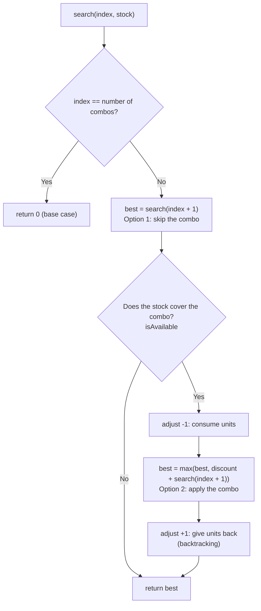
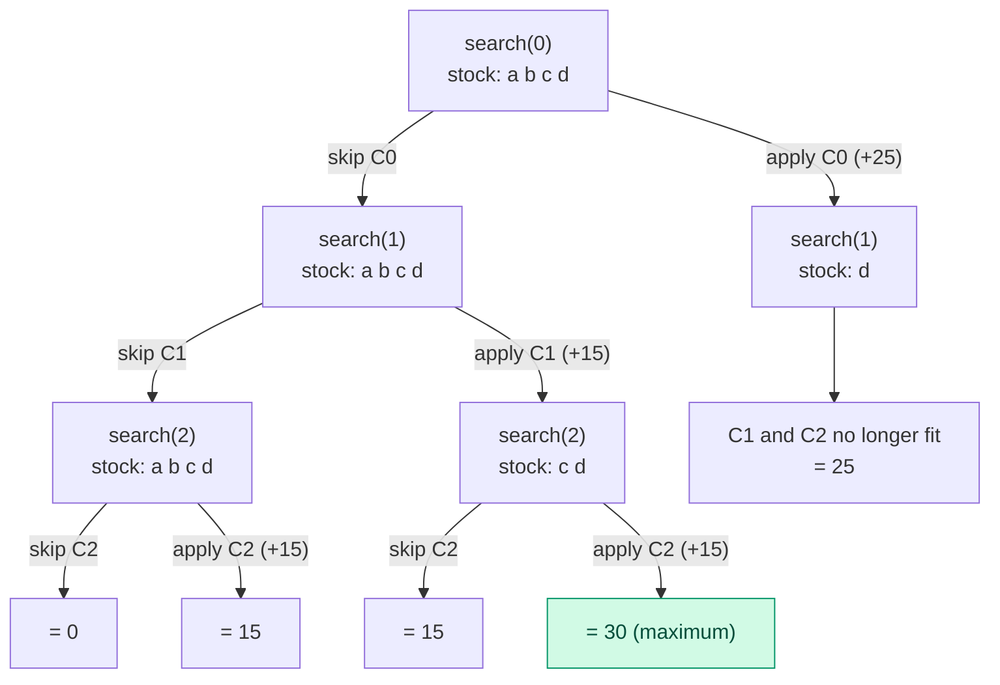

# Cinema Orders API

**English** | [Español](README.es.md)

REST microservice to manage **temporary purchase orders** for a cinema chain. Customers add tickets (`TICKET`) and food (`FOOD`) to an order before paying. The project also includes a **combo discount** engine (`DiscountCalculator`), ready to be integrated with orders in a later sprint.

## Contents

1. [Technologies](#technologies)
2. [Running the project](#running-the-project)
3. [Project structure](#project-structure)
4. [Endpoints](#endpoints)
5. [Business rules and validations](#business-rules-and-validations)
6. [Error handling](#error-handling)
7. [DiscountCalculator: how it works](#discountcalculator-how-it-works)
8. [Tests](#tests)
9. [Design decisions](#design-decisions)

## Technologies

| Technology | Purpose |
|---|---|
| Java 21 | Language |
| Spring Boot 3.5 (`spring-boot-starter-web`) | REST API |
| Bean Validation (`spring-boot-starter-validation`) | Input validation |
| Lombok | Less boilerplate in the models |
| Jackson | `snake_case` JSON (`spring.jackson.property-naming-strategy=SNAKE_CASE`) |
| `ConcurrentHashMap` | In-memory persistence (no database) |
| JUnit 5 + MockMvc (`spring-boot-starter-test`) | Unit and integration tests |
| Maven | Build |

## Running the project

Requirements: **JDK 21** and **Maven 3.9+** (or the `./mvnw` wrapper if the repository includes it).

```bash
mvn spring-boot:run          # starts the API at http://localhost:8080
mvn test                     # all tests
mvn test -Dtest=DiscountCalculatorTest   # discount tests only
```

The `postmanCollections/` folder contains a Postman collection to try the endpoints.

## Project structure

```
src/main/java/com/cinema
├── CinemaOrdersApplication.java
├── challenge/
│   └── DiscountCalculator.java        # maximum combo discount algorithm
├── controller/
│   └── OrderController.java           # REST endpoints and HTTP status codes
├── exception/
│   ├── GlobalExceptionHandler.java    # @RestControllerAdvice
│   ├── (OrderNotFound | OrderNotDeletable | InvalidOrder | InvalidRequest)Exception.java
│   └── model/                         # error response structure
│       ├── ApiError.java
│       └── ErrorDetail.java
├── model/
│   ├── Order.java, Item.java, ItemType.java, OrderStatus.java
│   └── request/                       # request bodies
│       ├── CreateOrderRequest.java    # POST body
│       ├── UpdateOrderRequest.java    # PATCH body
│       └── ItemRequest.java
├── repository/
│   └── OrderRepository.java           # ConcurrentHashMap
└── service/
    └── OrderService.java              # business rules
```

Request flow: `Controller` (HTTP and format validation) → `Service` (business rules) → `Repository` (storage). Errors are translated in a single place: `GlobalExceptionHandler`.

## Endpoints

Base path: `/v1/countries/{country}/orders`

| Method | Endpoint | Description | Status |
|---|---|---|---|
| `POST` | `/v1/countries/{country}/orders` | Create an order | `201` (with `Location` header) |
| `GET` | `/v1/countries/{country}/orders/{orderId}` | Get an order | `200` |
| `PATCH` | `/v1/countries/{country}/orders/{orderId}` | Update `items` and/or `status` | `200` |
| `DELETE` | `/v1/countries/{country}/orders/{orderId}` | Delete a `PENDING` order | `204` |

Path parameters: `country` is 2 letters (for example `MX`; stored in uppercase) and `orderId` is a UUID.

### Create an order

```bash
curl -X POST http://localhost:8080/v1/countries/MX/orders \
  -H "Content-Type: application/json" \
  -d '{"cinema_id":472,"user_id":"user-123","items":[
        {"type":"TICKET","name":"Adulto","price":85},
        {"type":"FOOD","name":"Combo 1","price":120}]}'
```

Response `201 Created`:

```json
{
  "order_id": "3f2c9a1e-5b7d-4c1a-9e2f-0a1b2c3d4e5f",
  "country": "MX",
  "cinema_id": "472",
  "user_id": "user-123",
  "items": [
    { "type": "TICKET", "name": "Adulto", "price": 85.00 },
    { "type": "FOOD", "name": "Combo 1", "price": 120.00 }
  ],
  "total": 205.00,
  "status": "PENDING",
  "created_at": "2026-10-28T10:30:00"
}
```

### Get, update and delete

```bash
curl http://localhost:8080/v1/countries/MX/orders/{orderId}

curl -X PATCH http://localhost:8080/v1/countries/MX/orders/{orderId} \
  -H "Content-Type: application/json" \
  -d '{"items":[{"type":"TICKET","name":"Adulto","price":85}]}'

curl -X PATCH http://localhost:8080/v1/countries/MX/orders/{orderId} \
  -H "Content-Type: application/json" \
  -d '{"status":"CONFIRMED"}'

curl -X DELETE http://localhost:8080/v1/countries/MX/orders/{orderId}
```

`status` values: `PENDING`, `CONFIRMED`, `CANCELLED`. Item types: `TICKET`, `FOOD`.

## Business rules and validations

**Business rules**

- `total` is calculated automatically: the sum of the item prices, with 2 decimals.
- On creation: a UUID, the `PENDING` status and the creation timestamp are assigned.
- An order must contain **at least one `TICKET` item**; the rest may be `FOOD`.
- Only a `PENDING` order can be deleted.
- PATCH only modifies `items` and `status`. If the items change, `total` is recalculated.
- The `country` in the path must match the order's country; otherwise the order is treated as not found.

**Format validation (HTTP 400)**

| Field | Rule |
|---|---|
| `cinema_id` | Required, integer greater than 0. Message: `cinema_id invalido. El valor debe ser mayor a 0.` |
| `user_id` | Required, not blank |
| `items` | Required list with at least one element |
| `items[].type` | Required (`TICKET` or `FOOD`) |
| `items[].name` | Required, not blank |
| `items[].price` | Required, greater than 0, at most 2 decimals |
| `status` (PATCH) | Must be a valid `OrderStatus` value |
| `{orderId}` | UUID format |
| `{country}` | 2 letters |

## Error handling

Every error uses the same structure (`ApiError`):

```json
{
  "timestamp": "2026-10-28T10:15:30",
  "status": 400,
  "error": "Bad Request",
  "code": "VALIDATION_ERROR",
  "message": "Request validation failed",
  "path": "/v1/countries/MX/orders",
  "details": [
    { "field": "cinema_id", "message": "cinema_id invalido. El valor debe ser mayor a 0." }
  ]
}
```

`details` only appears on validation errors.

| HTTP | `code` | When |
|---|---|---|
| 400 | `VALIDATION_ERROR` | Null or blank fields, empty list, invalid `orderId` or `country` format |
| 400 | `MALFORMED_REQUEST` | Invalid JSON or wrong enum value (the message lists the allowed values) |
| 400 | `INVALID_REQUEST` | PATCH with neither `items` nor `status` |
| 404 | `ORDER_NOT_FOUND` | The order does not exist for that country |
| 422 | `INVALID_ORDER` | Business rule: the order has no `TICKET` item |
| 422 | `ORDER_NOT_DELETABLE` | Trying to delete an order that is not `PENDING` |
| 500 | `INTERNAL_ERROR` | Any other exception; the message is generic and the detail only goes to the log |

## DiscountCalculator: how it works

Class: `com.cinema.challenge.DiscountCalculator`. It is not yet connected to the orders API.

### The problem

Given what a customer bought, the combo rules and the discount of each combo, compute the **maximum discount** that can be obtained.

- Each combo can be applied **only once**.
- A product **cannot be reused**: each purchased unit belongs to at most one combo.
- The **maximum** discount is sought.

```java
int maxDiscount(String[] purchased, String[][] combos, int[] discounts)
```

Example: `purchased = [popcorn, soda, nachos, popcorn, soda]`, `combos = [[popcorn, soda], [nachos, soda]]`, `discounts = [20, 15]` returns **35**. Combo 1 uses one popcorn and one soda; combo 2 uses the nachos and the other soda. The second popcorn belongs to no combo.

Constraints (validated, they throw `IllegalArgumentException`): `purchased.length <= 50`, `1 <= combos.length <= 10`, `1 <= combos[i].length <= 5`, `discounts.length == combos.length`, no `null` values. An empty purchase returns 0.

### Why a greedy algorithm is not enough

Always taking the combo with the highest discount can fail. With purchase `a, b, c, d` and combos `{a,b,c}` = 25, `{a,b}` = 15 and `{c,d}` = 15:

- Greedy takes `{a,b,c}` (25) and nothing else fits, result **25**.
- The optimum is to drop the 25 combo and apply `{a,b}` + `{c,d}`, result **30**.

Combinations have to be explored, which is what **recursion with backtracking** does.

### The idea in one sentence

For each combo there are two options: **skip it** or **apply it** (if the stock allows). The recursion tries both for every combo and keeps the largest sum.

### Data preparation

| Input | Becomes | Example |
|---|---|---|
| `purchased` | `stock`: `Map<product, quantity>` | `{popcorn=2, soda=2, nachos=1}` |
| `combos[i]` | `required[i]`: units the combo needs | `{soda=2}` for `[soda, soda]` |

Counting units (instead of only checking that the product is present) is what handles repeated products, such as a `[soda, soda]` combo.

### The `search` method

`search(index, stock, required, discounts)` answers: *with the current stock, what is the maximum discount I can get from the combos at position `index` through the last one?*

```java
private int search(int index, Map<String, Integer> stock,
                   List<Map<String, Integer>> required, int[] discounts) {
    if (index == required.size()) {
        return 0;                                                   // base case
    }
    int best = search(index + 1, stock, required, discounts);       // option 1: skip

    Map<String, Integer> need = required.get(index);
    if (isAvailable(stock, need)) {                                 // does the stock cover it?
        adjust(stock, need, -1);                                    // consume units
        best = Math.max(best,
                discounts[index] + search(index + 1, stock, required, discounts)); // option 2: apply
        adjust(stock, need, +1);                                    // backtracking
    }
    return best;
}
```



Helper methods:

- `isAvailable(stock, need)`: true if there are enough units of **every** product the combo requires.
- `adjust(stock, need, sign)`: removes (`-1`) or gives back (`+1`) the units a combo uses.

### Recursion tree for the example

Purchase `a, b, c, d`; **C0** = `{a,b,c}` (25), **C1** = `{a,b}` (15), **C2** = `{c,d}` (15). Each level decides one combo.



Each leaf is the total discount of one path. `search` returns the largest: **30**.

### Why the stock is restored (backtracking)

`stock` is **a single `Map` shared** by all the calls, and it is modified in place to avoid copying it on every branch. That is why, after exploring "apply", the units must be given back with `adjust(..., +1)`: the next branch has to start from the original stock. Think of a shared workbench: you put the pieces back before trying another combination.

Without that line the consumption "leaks" into the following branches. With the example above the result would be **15 instead of 30**, with no exception to warn about it.

### Complexity

- **Recursion depth:** equal to the number of combos (at most 10), so there is no risk of stack overflow.
- **Time:** each combo is either skipped or applied, so there are at most 2¹⁰ = 1,024 paths, trivial for these limits.

## Tests

| Class | What it covers |
|---|---|
| `DiscountCalculatorTest` | Challenge tests (6 scenarios) |
| `DiscountCalculatorAdditionalTest` | Only what the previous one does not verify: detecting a greedy algorithm, insufficient quantity of a repeated product, and constraint validation |
| `OrderServiceTest` | Order business rules (total, required TICKET, PATCH, DELETE) |
| `OrderControllerIntegrationTest` | Endpoints with MockMvc: HTTP status codes and error structure |

## Design decisions

- **Money as `BigDecimal`** with 2 decimals, instead of `double`.
- **`country` is normalized to uppercase** (`mx` and `MX` are the same country).
- **PATCH ignores fields that are not allowed** (for example `cinema_id`) instead of rejecting them.
- **Any `status` change is valid**; no transition rules are defined.
- **Repository with atomic operations** (`computeIfPresent`) to update, and to delete only when `PENDING`; stored orders are treated as immutable.

## Next steps

- Integrate `DiscountCalculator` with order creation and update (combo catalog, definition of `total` and `discount`).
